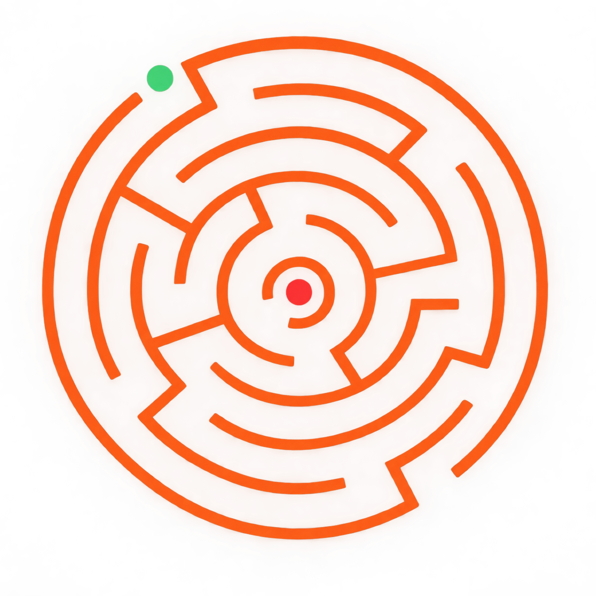

# Maze

A maze generation application built with **Go** and **React**. Generate random mazes and explore them in both 2D and 3D.

  

## Features

- Generate random mazes.
- View mazes in 2D and 3D.
- Go-powered maze generation.
- React-based interface.
- Local HTTP communication between the frontend and backend.

## Built With

- **Go** – Maze generation.
- **React** – User interface.
- **HTTP** – Communication between Go and React.

## How It Works

1. Generate a maze using the application.
2. Go creates the maze and sends it to the frontend through local HTTP.
3. React displays the maze in 2D or 3D.

---

Made with Go and React.
